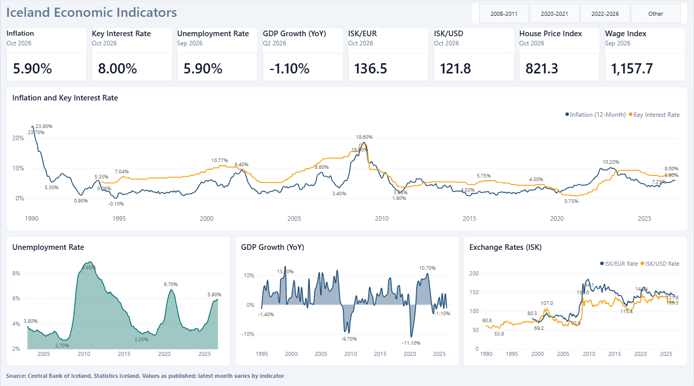
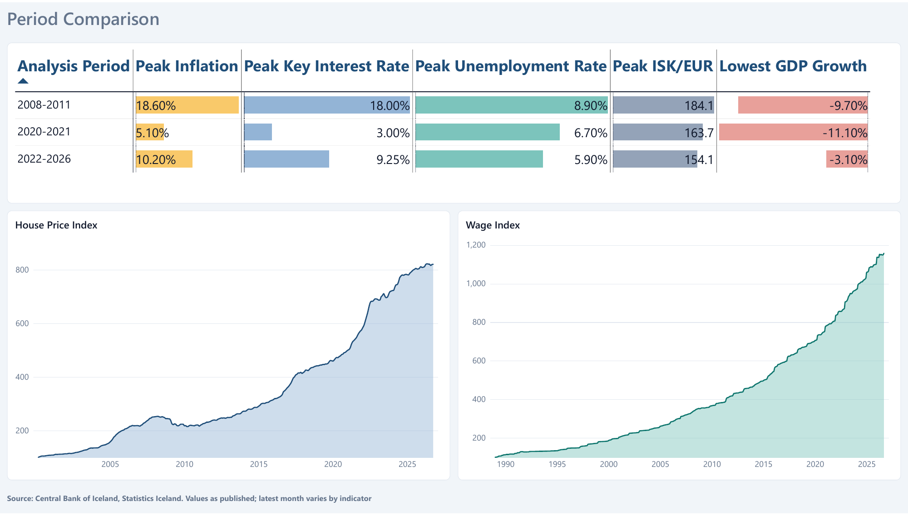
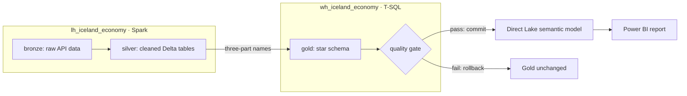
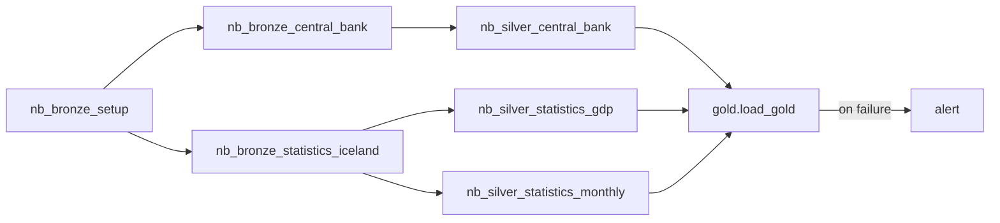
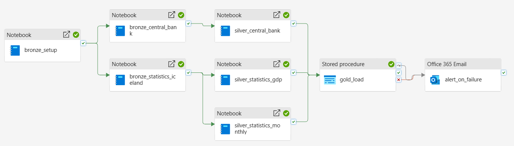
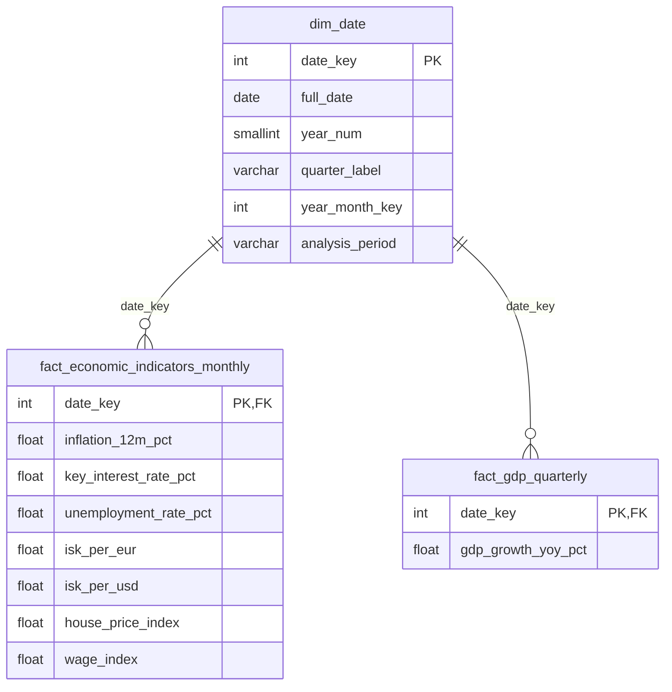
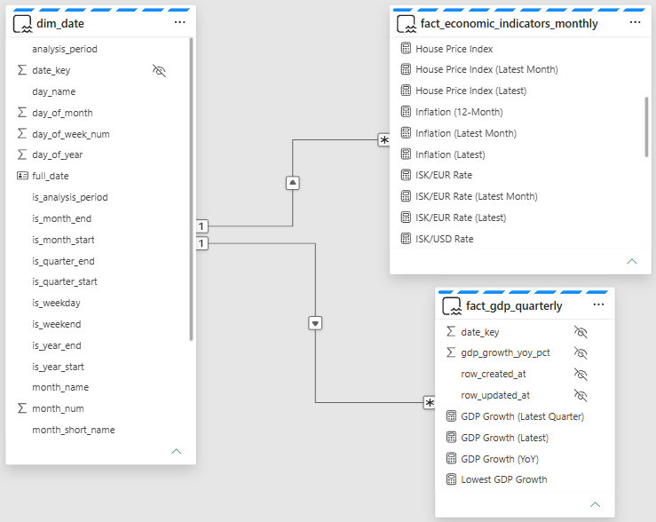

# Iceland Economic Analytics

A Microsoft Fabric project that loads monthly economic indicators for Iceland from the Central Bank of Iceland and Statistics Iceland, models them in a Fabric Data Warehouse, and serves them through a Direct Lake semantic model and a Power BI report.

A portfolio project that follows the skill areas of **DP-600** (Fabric Analytics Engineer) and **DP-700** (Fabric Data Engineer).

| Area | Where |
|---|---|
| API ingestion (full and incremental) and Spark transformations | [`notebooks/`](notebooks) |
| Orchestration: pipeline DAG with shared Spark session | [Pipeline](#pipeline) |
| Star schema, T-SQL load procedures, transactions | [`warehouse/01–03`](warehouse) |
| Data quality gate with rollback | [`warehouse/03_validate_and_run.sql`](warehouse/03_validate_and_run.sql) |
| Least-privilege security and monitoring | [`warehouse/04_security.sql`](warehouse/04_security.sql), [`05_monitoring.sql`](warehouse/05_monitoring.sql) |
| Direct Lake semantic model, DAX and TMDL | [`semantic_model/`](semantic_model) |
| Design decisions and data validation | [Design Decisions](#design-decisions), [Data Validation](#data-validation) |

---

## Data

Eight indicators, monthly, with the full history each source publishes (Central Bank series from 1990):

| Indicator | Source | Unit |
|---|---|---|
| Inflation: consumer price index, 12-month change | Central Bank of Iceland (XML API) | % |
| Key interest rate | Central Bank of Iceland | % per year |
| Unemployment rate, Labour Force Survey (trend) | Statistics Iceland (PX-Web API) | % |
| GDP, annual change by quarter (gross domestic product) | Statistics Iceland | % |
| Exchange rate, EUR (monthly average of daily rates) | Central Bank of Iceland | ISK per EUR |
| Exchange rate, USD (monthly average of daily rates) | Central Bank of Iceland | ISK per USD |
| Market price index of residential housing, whole country | Statistics Iceland | Index |
| Wage index, monthly | Statistics Iceland | Index |

No derived indicators: the only processing is a monthly average of daily exchange rates and the last key interest rate in each month. Each source publishes on its own schedule (GDP about 6–8 weeks after quarter end, house prices and wages about 2 months after the month, unemployment from 2003), so the latest month differs between indicators.

`dim_date[analysis_period]` groups months into three comparison periods, labelled by year only: `2008-2011`, `2020-2021` and `2022-2026`; all other months are `Other`.

---

## Report



**Key indicators.** Eight KPI cards with the latest value and its month (inflation, key interest rate, unemployment, GDP growth, ISK/EUR, ISK/USD, house prices, wages), inflation and the key interest rate over time, and unemployment, GDP growth and exchange rates below, with a period filter.



**Period comparison.** Highest and lowest values in each analysis period, and the house price and wage indexes over time.

---

## Architecture



| Layer | Item | Notes |
|---|---|---|
| Bronze | Lakehouse | PySpark: raw API responses, stored as-is |
| Silver | Lakehouse | Spark SQL: typed, deduplicated Delta tables, loaded with `MERGE` |
| Gold | Warehouse | T-SQL: Kimball star schema: one conformed date dimension, one fact table per grain; reads Silver in place with three-part names |
| Semantic model | Direct Lake | 30 DAX measures, defined in TMDL |
| Consumption | Power BI | Measures in the report |

This is Microsoft's [Pattern 2](https://learn.microsoft.com/fabric/onelake/onelake-medallion-lakehouse-architecture#deployment-model): Bronze and Silver in a lakehouse, Gold in a warehouse. Microsoft also suggests a separate workspace per layer for governance. Here everything is in one workspace and Bronze and Silver are schemas in one lakehouse, for two reasons: the warehouse reads Silver with three-part names, which work within a workspace, and the pipeline's notebooks can share one Spark session only when they have the same default lakehouse.

### Pipeline

`pl_load_iceland_economy` runs the whole load as one dependency graph:



- **One Spark session.** High concurrency for pipelines is on, and every notebook activity has the same session tag, so the notebooks share one session. A trial capacity has no Spark job queue, so separate sessions that overlap would fail with HTTP 430.
- **Parallel where possible.** The two Bronze notebooks run side by side; each Silver notebook starts when its Bronze table is ready.
- **Incremental by default.** The pipeline parameter `load_mode` (`incremental` or `full`) is passed to both Bronze notebooks. Incremental runs read from a watermark with a lookback (Central Bank: the latest date in Bronze minus two months; Statistics Iceland: the last 24 months and 8 quarters through a PX-Web `top` filter) and append; `full` reloads the whole history. Silver keeps the latest version of each observation, so revisions overwrite older values and re-reads never duplicate rows.
- **Retries** on the two API notebooks (1 retry after 60 seconds).
- **All or nothing in Gold.** `gold.load_gold` is a stored procedure activity that runs only when all three Silver notebooks succeed.



---

## Warehouse

| Script | Contents |
|---|---|
| [`01_tables.sql`](warehouse/01_tables.sql) | `gold` schema, dimensions, fact table, `dq_logs`; keys declared `NOT ENFORCED` |
| [`02_load_procedures.sql`](warehouse/02_load_procedures.sql) | One `MERGE` procedure per table; the monthly fact pivots one row per indicator into one column per indicator; only changed rows are rewritten |
| [`03_validate_and_run.sql`](warehouse/03_validate_and_run.sql) | Quality gate and `gold.load_gold` |
| [`04_security.sql`](warehouse/04_security.sql) | Roles `gold_reader` (star schema only) and `gold_loader` (run the load only) |
| [`05_monitoring.sql`](warehouse/05_monitoring.sql) | Load history, slowest statements and failures from Query Insights and `dq_logs` |

**Quality gate.** `gold.load_gold` runs all loads and the checks in one transaction. `gold.validate_gold` checks one row per month and per quarter, keys on the first day of the period, referential integrity to `dim_date`, value ranges per column, that every indicator has data (a renamed source series fails here), volume and completeness. If any check fails, the transaction rolls back, the failure is logged to `gold.dq_logs` and the error is re-thrown so the pipeline fails. This matters with Direct Lake: the model picks up committed data automatically, so bad rows must never be committed.

**Fabric Warehouse notes.** Text is `varchar` (UTF-8), timestamps `datetime2(6)`, keys `NOT ENFORCED` (integrity is checked in the gate), and the date spine uses a cross join instead of a recursive CTE.

### Star schema



Designed after Kimball's dimensional modelling rules:

| Rule | How it's applied |
|---|---|
| One grain per fact table | Monthly indicators and quarterly GDP are separate periodic snapshots, so GDP is never placed on a monthly row |
| Dense facts as columns | Every indicator is published every period, so each is a column named with its unit (`_pct`, `isk_per_`, `_index`) rather than rows in a generic value column |
| Conformed date dimension | One day-grain `dim_date` serves both facts and is the model's date table; facts join on the first day of their month or quarter |
| Only real dimensions | Source and units belong to the indicator, not to each row, so they're documented on the columns and measures instead of in single-row dimensions |
| Non-additive facts | Rates and indexes are averaged over time, never summed; peaks and lows use `MAX` and `MIN` |

Percentages are stored as percentage points (9.25 = 9.25%). A NULL means the source hasn't published that month yet.

---

## Semantic Model

`sm_iceland_economy` is a Direct Lake on OneLake model on the three `gold` tables with 30 measures, built to DP-600 practice:

- **Star schema** with many-to-one, single-direction relationships from each fact to `dim_date`, which is marked as the date table.
- **Explicit measures only.** Fact columns and keys are hidden, so reports use the measures and their formats.
- **Defined in code.** [`measures_1_base.tmdl`](semantic_model/measures_1_base.tmdl) and [`measures_2_derived.tmdl`](semantic_model/measures_2_derived.tmdl) are TMDL scripts that create every measure with its format string, display folder and description (two steps, because derived measures reference the base measures); [`relationships.tmdl`](semantic_model/relationships.tmdl) adds the relationships if the model didn't detect them.

| Folder | Measures | Definition |
|---|---|---|
| Indicators | `Inflation (12-Month)`, `Key Interest Rate`, `Unemployment Rate`, `GDP Growth (YoY)`, `ISK/EUR Rate`, `ISK/USD Rate`, `House Price Index`, `Wage Index` | The indicator's value, as defined in [Data](#data) |
| Latest | `… (Latest)` | Value in the latest month or quarter with data, within the current filters |
| Latest | `… (Latest Month)`, `GDP Growth (Latest Quarter)` | That period as text, for example `Sep 2026` or `Q2 2026`, for KPI cards |
| Latest | `Wage Index (Latest Text)` | The latest wage index formatted as text, because the card visual abbreviates large numbers (1157.7 as 1.2K) |
| Period Comparison | `Peak Inflation`, `Peak Key Interest Rate`, `Peak Unemployment Rate`, `Peak ISK/EUR`, `Lowest GDP Growth` | Highest or lowest value in the selected period |



**Security note.** The SQL roles in [`04_security.sql`](warehouse/04_security.sql) protect the warehouse. A Direct Lake on OneLake model reads the Delta files directly and does not apply them, so access to the model and report is controlled with workspace roles and model permissions.

---

## Design Decisions

| Decision | Why |
|---|---|
| Bronze and Silver in a lakehouse, Gold in a warehouse | Spark suits API ingestion and Delta merges; T-SQL suits a governed star schema with transactions, and the warehouse reads Silver in place |
| Direct Lake on OneLake, not Import or DirectQuery | No refresh step and no DirectQuery fallback: the model reads committed Gold data, so the quality gate decides what reports show |
| Quality gate with rollback in `gold.load_gold` | With Direct Lake a bad commit is visible immediately, so checks run inside the load transaction and a failure leaves Gold unchanged |
| Day-grain `dim_date` for monthly and quarterly facts | One conformed date table keeps time intelligence and the period filter simple; facts join on the first day of their period |
| One fact table per grain | GDP is quarterly and the other indicators are monthly, so GDP is not repeated on monthly rows |
| Incremental load with a lookback window | Sources revise recent values; reading from a watermark minus a lookback and keeping the latest version in Silver picks up revisions without reloading everything |
| One workspace and one lakehouse with schemas | Three-part names in the warehouse work within a workspace, and notebooks in one pipeline session need the same default lakehouse |
| Measures in TMDL scripts in Git | The model's logic is reviewable and can be re-applied; fact columns are hidden so reports use the measures |

---

## Data Validation

Beyond the checks in the quality gate, the latest loaded values were compared by hand with the sources:

| Indicator | Checked against |
|---|---|
| Inflation, latest month | Statistics Iceland's consumer price index release |
| Key interest rate | The Monetary Policy Committee's latest statement |
| Unemployment rate | Statistics Iceland's PX-Web table for the Labour Force Survey |
| ISK/EUR and ISK/USD | The Central Bank's published daily rates (the Silver table holds the daily rates; Gold stores their monthly average) |
| Wage index | The month-on-month and annual changes in Statistics Iceland's release |
| GDP growth, last four quarters | Statistics Iceland's PX-Web table THJ01601 (year-on-year change, total GDP) |

The house price index was not compared by hand; it is loaded the same way as the checked Statistics Iceland indicators and passes the quality gate.

A manual check of Bronze found no unparseable dates and no empty values in the Central Bank, GDP or monthly Statistics Iceland data. Bronze holds the full Central Bank dataset (35 series); Silver keeps the four the model uses.

---

## Limitations and Next Steps

- **No shrunken month dimension.** Month-level slicing uses `dim_date`; a `dim_month` would be the next modelling step.
- **Period filter only.** A year-range slicer would let users compare any two periods.
- **Model security.** Access to the model relies on workspace roles; row-level security is not configured.
- **Quality checks only in Gold.** Silver deduplicates and drops invalid rows without counting them, and the Spark transformations have no unit tests.

---

## Project Structure

```text
├── notebooks/                          # Lakehouse: Bronze in PySpark, Silver in Spark SQL
│   ├── bronze/                               # PySpark: API ingestion, full or incremental
│   └── silver/                               # Spark SQL: CREATE TABLE IF NOT EXISTS + MERGE
├── warehouse/                          # Warehouse (T-SQL)
│   ├── 01_tables.sql                         # dim_date, two fact tables, dq_logs
│   ├── 02_load_procedures.sql                # MERGE procedure per table
│   ├── 03_validate_and_run.sql               # Quality gate and gold.load_gold
│   ├── 04_security.sql                       # Least-privilege roles
│   └── 05_monitoring.sql                     # Load history and failures
├── semantic_model/                     # TMDL scripts: measures, relationships
├── report/                             # Power BI report theme
└── assets/                             # Screenshots
```

---

## Naming

Fabric items use a type prefix and snake_case; warehouse objects use medallion schemas and `dim_` / `fact_` tables.

| Item | Name |
|---|---|
| Lakehouse (Bronze, Silver) | `lh_iceland_economy` |
| Warehouse (Gold) | `wh_iceland_economy` |
| Notebooks | `nb_bronze_*`, `nb_silver_*` |
| Pipeline | `pl_load_iceland_economy` |
| Semantic model | `sm_iceland_economy` |
| Report | `rpt_iceland_economy` |

---

## How to Run

Requires a Fabric workspace on a trial or paid capacity.

1. Create a lakehouse `lh_iceland_economy` with **Lakehouse schemas** enabled. Import the six notebooks from `notebooks/` and set the lakehouse as each one's default.
2. In **Workspace settings → Data Engineering/Science → Spark settings → High concurrency**, turn on **For pipeline running multiple notebooks**.
3. Create the pipeline `pl_load_iceland_economy` with the six notebook activities as in [Pipeline](#pipeline), each with the session tag `iceland_economy`. Add a pipeline parameter `load_mode` (String, default `incremental`) and pass it to both Bronze activities as the base parameter `load_mode`. Run it; the first run loads the full history because Bronze is empty.
4. Create a warehouse `wh_iceland_economy` in the same workspace and add the lakehouse in its Explorer. Run `warehouse/01`–`04`, then add the stored procedure activity `gold.load_gold` to the pipeline, after the three Silver notebooks, and run the pipeline again.
5. Create a Direct Lake semantic model `sm_iceland_economy` on `dim_date`, `fact_economic_indicators_monthly` and `fact_gdp_quarterly`. In TMDL view, apply `semantic_model/relationships.tmdl` (the relationships are not detected from the warehouse keys), then `measures_1_base.tmdl` and `measures_2_derived.tmdl`, in that order. Mark `dim_date` as the date table and hide the fact columns. Build the report `rpt_iceland_economy` on it.
